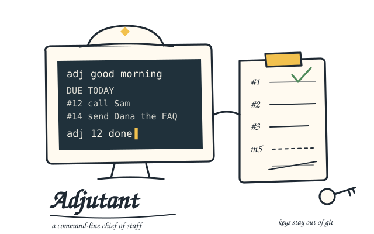

# Adjutant

A command-line chief of staff. You talk to it in plain English; it keeps your task list honest, writes down what you decide and promise, tells you what's slipping, and opens and closes your day.



```
$ adj good morning
$ adj push 12 Monday
$ adj I owe Dana the revised FAQ tomorrow
Noted m4 (promise): I owe Dana the revised FAQ tomorrow
Add it to Todoist too? Say yes and I'll run: adj add I owe Dana the revised FAQ tomorrow
$ adj yes
Added #31  I owe Dana the revised FAQ  — tomorrow
$ adj what am I forgetting
1. #7 (Renew the domain) has been pushed 4 times
   → adj 7 done   (if it no longer matters)
```

## What it is

Adjutant is the public, de-personalized spin-off of **Blackbox**, a private command-line secretary its author has used every day since September 2026. It's the same engine and the same patterns, with no names, clients, data, prompts or server details. It's MIT-licensed, about 1,500 lines of standard-library Python, and covered by 40 tests that run the real command against fake services.

What it does:

- **Tasks, through Todoist.** Todoist is the official list. Adjutant gives every task a short permanent number (`#12`), keeps a local history of every change (including the ones you make in the Todoist app), and still answers "what did I finish this week?" after Todoist has forgotten.
- **Minutes, from plain sentences.** "I decided…", "I owe Dana…", "Sam owes me…", "note: …". There's no model call, and nothing is deleted: corrections supersede and "scratch that" strikes.
- **Briefs.** `good morning`, `good night` and `week in review` build a record from your tasks and minutes, make one model call to write it up, and store both.
- **What am I forgetting.** Stale overdue tasks, tasks you keep pushing, old promises, people you're still waiting on. You can snooze any finding with a reason, and it comes back on its own.
- **People.** `adj who is Dana` reads a profile from your [oversoul](https://github.com/chrisabraham/oversoul) folder, the shared Markdown memory your other AI agents keep.

What it isn't: a product with support, a chatbot, or an agent that acts on its own. It never sends anything. It changes your task list only when you tell it to, and model suggestions run only after you say "yes".

## Who it's for

- **Anyone with more open loops than memory.** If you live in a terminal and things slip, it's built for you.
- **People who want to borrow the patterns.** If you're building your own assistant, take the patterns one at a time. Each one is a short module with tests.
- **Agents.** `AGENTS.md` tells an AI coding agent how to work on this repo safely.

## Why

Most assistants are a chat window with a memory problem. Adjutant goes the other way: deterministic first, the model last.

- The things you say every day are fixed phrasings: `12 done`, `push 12 Monday`, `I decided…`. They're instant, free, and testable. They never go to a model.
- The model only writes (briefs) and answers open questions. It never decides what changed.
- Nothing you say, decide, promise, or are owed gets lost, because nothing is ever deleted.

## How to use it

```sh
pipx install git+https://github.com/chrisabraham/adjutant.git        # or: pip install --user ...
pipx inject adjutant-cli anthropic                                   # optional: briefs and questions
adj init                                                             # paste your Todoist token (hidden)
adj today
```

`adj` with no arguments opens an interactive session. `adj help` lists the commands. The full walkthrough is in [docs/setup.md](docs/setup.md): installing, the Todoist token, the optional Anthropic key, running it on a small server you SSH into, nightly encrypted backups, and the morning brief on a timer.

The everyday commands:

```
adj today · adj overdue · adj tasks · adj add call Sam Friday p1
adj 12 done · adj 12 13 done · adj push 12 Monday · adj push 12 14 next Friday · adj reopen 12
adj history of 12 · adj what did I finish this week
adj I decided … · adj I owe Dana … · adj Sam owes me … · adj note: … · adj idea: …
adj what happened today · adj what am I waiting on · adj what do I owe Dana
adj correction: … · adj scratch that · adj m5 resolved
adj good morning · adj good night · adj week in review
adj what am I forgetting · adj snooze 2 for 7 days because waiting on the client
adj who is Dana · adj models · adj use sonnet for chat · adj spend · adj status
```

Anything else is a question for the model. A trailing `?` always makes it one.

## Where things live

| What | Where |
|---|---|
| The code | this repo; installs as the `adj` command |
| Settings and secrets | `~/.config/adjutant/` (mode 700, never in git) |
| The database | `~/.local/share/adjutant/adjutant.sqlite3` |
| Encrypted backups | `~/.local/share/adjutant/backups/`, plus an optional private git repo |

## The patterns

Each is a short module you can read in one sitting. [docs/patterns.md](docs/patterns.md) explains why each one exists and what goes wrong without it.

1. **An outside authority plus a local append-only history:** `adjutant/ledger.py`
2. **Deterministic plain English first, tested by replaying your own phrasings:** `adjutant/router.py`, `tests/phrases.tsv`
3. **Minutes as data, with supersede and strike instead of delete:** `adjutant/minutes.py`
4. **Briefs: gather a packet, make one model call, store the result:** `adjutant/briefs.py`
5. **"What am I forgetting," with snoozes that remember why:** `adjutant/forgetting.py`
6. **Outside actions only on a human yes:** `router.offer` and `RUNNABLE`
7. **A model per job, with fallbacks and a cost ledger:** `adjutant/model.py`
8. **Tests that run the real CLI against fakes in a throwaway home folder:** `tests/fakes.py`
9. **An encrypted nightly backup with a tested restore:** `tools/backup.sh`
10. **Secrets and data that cannot reach git:** `.gitignore`, `adj init`, `tools/release_check.py`

## When

- **2026-09-30:** Blackbox's first commit. It grows one feature at a time, from daily use.
- **2026-10-18:** Adjutant is announced. Blackbox is being scrubbed for a public release.
- **2026-10-24:** first release, 0.1.0. Adjutant is a clean rewrite of the engine, not the private repo with names removed. Scrubbing a working personal tool leaks; writing it fresh doesn't. Every release passes `tools/release_check.py` against a private denylist kept outside the repo.

See [CHANGELOG.md](CHANGELOG.md).

## Status

Show-and-tell: an example, not a product. It works, it's tested, and it's used, but there's no roadmap and no support promise. Issues and pull requests are welcome; read [CONTRIBUTING.md](CONTRIBUTING.md) first.

## Related

- [oversoul](https://github.com/chrisabraham/oversoul): a shared memory for a team of AI agents, kept as plain Markdown in one private Git repo. Adjutant reads it for `who is`.
- [The project page](https://chrisabraham.net/projects.html#adjutant) · [The wiki entry](https://chrisabraham.net/wiki/adjutant.html) · [Blackbox, described](https://chrisabraham.net/wiki/blackbox.html)

## License

MIT. See [LICENSE](LICENSE). Started by [Chris Abraham](https://chrisabraham.net). "Adjutant" was a chatbot's coinage, adopted on sight.
